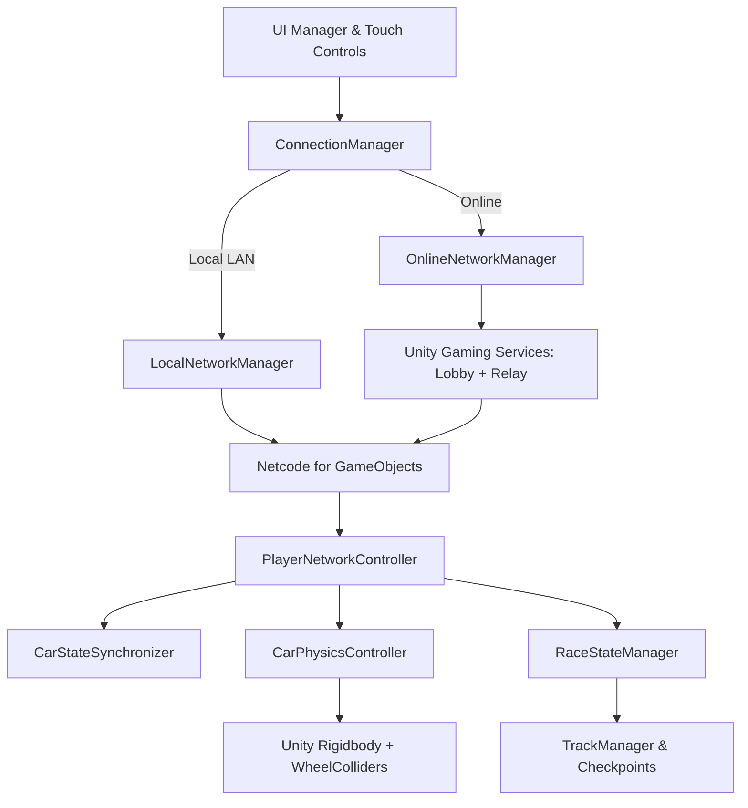

# 🏛️ Project Architecture: 3D Android Multiplayer Racing Game

## 1. System Architecture Overview

The project is structured with strict modularity separating networking, car physics, race orchestration, and rendering:

---

## 2. Component Breakdown

### A. Connection Layer
- **`ConnectionManager.cs`**:
  - Singleton orchestrating Netcode for GameObjects lifecycle across both LAN and Relay transports.
  - Switches between `LocalLAN` and `OnlineRelay` without altering gameplay code.
- **`LocalNetworkManager.cs`**:
  - Manages UDP multicast broadcast on port 47777 for LAN room discovery.
  - Binds local socket and offers manual IP connection fallback.
- **`OnlineNetworkManager.cs`**:
  - Initializes Unity Services (`UnityServices.InitializeAsync()`).
  - Signs in player anonymously via `AuthenticationService`.
  - Creates 4-player Relay allocations and registers public room codes in `LobbyService`.

### B. Vehicle Simulation & Dynamics
- **`CarPhysicsController.cs`**:
  - Authoritative physics driven by Unity `Rigidbody` and 4 `WheelCollider` components.
  - Realistic Ackermann speed-sensitive steering angle calculation.
  - Anti-roll stabilization bars connecting left and right wheel pairs to prevent rollovers on tight corners.
  - Downforce proportional to linear velocity squared ($F = c \cdot v^2$).
  - Dual exhaust nitro system applying forward force boost with fuel depletion and cooldown regen.
- **`WheelVisualSync.cs`**:
  - Extracts `GetWorldPose` from physical WheelColliders and updates visual 3D rim/tire meshes.

### C. State Synchronization & Networking
- **`CarStateSynchronizer.cs`**:
  - Host-authoritative synchronization model.
  - Authoritative host executes the Rigidbody simulation and transmits compact state structures (Position, Rotation, Velocity, Speed, Timestamp).
  - Remote client applies dead-reckoning extrapolation and spherical interpolation (Slerp) to eliminate packet loss jitter on mobile Wi-Fi.
- **`PlayerNetworkController.cs`**:
  - Derives from `NetworkBehaviour`.
  - Captures local touch inputs on owning client and delivers them to the Host via `[ServerRpc(Delivery = RpcDelivery.Unreliable)]`.
  - Host validates inputs, clamping values to valid ranges $(-1.0 \le input \le 1.0)$ to prevent cheating.

### D. Race Logic & Anti-Cheat
- **`RaceStateManager.cs`**:
  - Synchronized network race state machine (`WaitingForPlayers`, `Countdown`, `Racing`, `Completed`).
  - Lap tracking with strict sequential checkpoint validation: players cannot skip checkpoints or cut track curves.
  - Validates finish orders (1st, 2nd, 3rd, 4th) and records finish times on the authoritative host.

---

## 3. Android Performance Optimization (URP)
- **Frame Rate Target**: Locked to 60 FPS (`Application.targetFrameRate = 60`, `QualitySettings.vSyncCount = 0`).
- **Screen Awake**: `Screen.sleepTimeout = SleepTimeout.NeverSleep` prevents screen sleep during multiplayer sessions.
- **Shadow Distance**: Tuned to 45 meters with soft directional cascades for mobile GPU efficiency (Adreno / Mali).
- **Forward Rendering**: URP Forward renderer path with single-pass shadow atlas.
- **Texture Compression**: ASTC 6x6 block format for optimal texture bandwidth.

